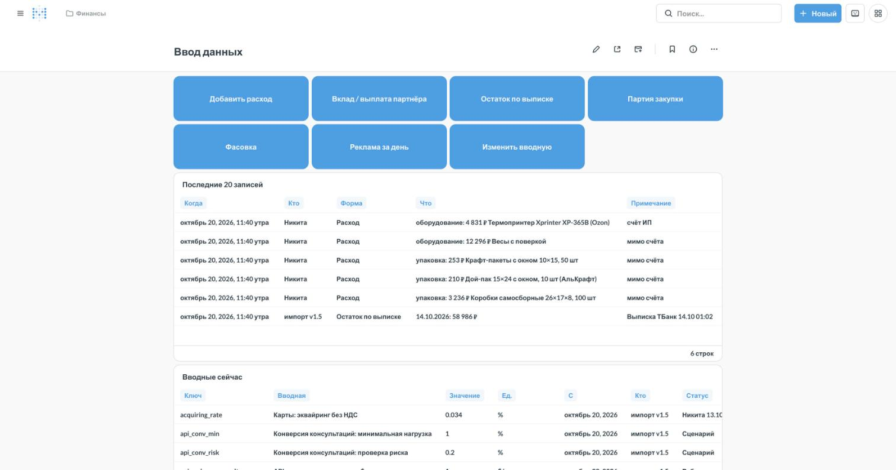
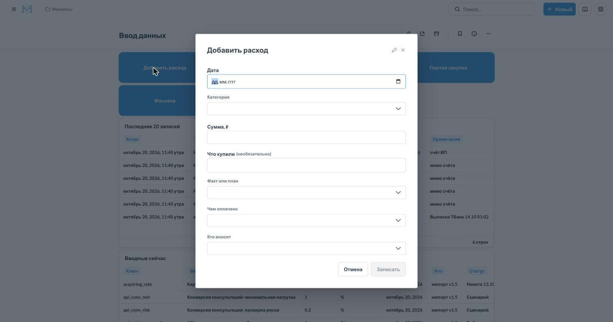
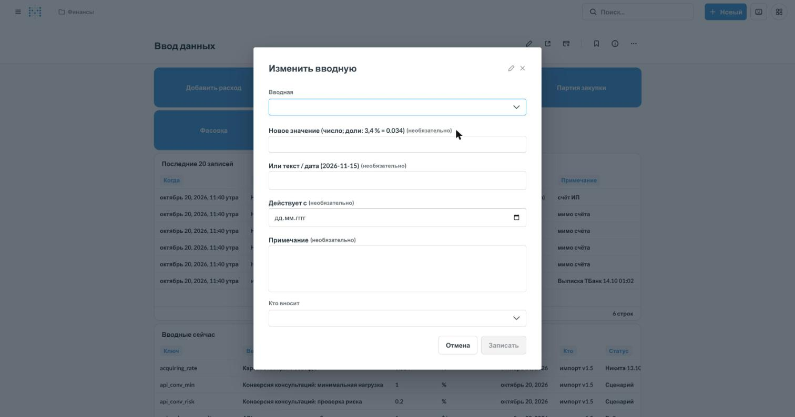
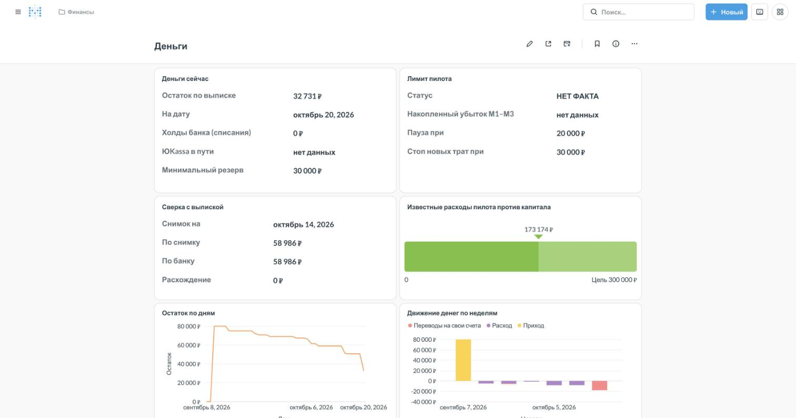

# Финмодель в базе бота: схема `fin`

Сюда переехала Google-таблица «Финмодель_Два_чайника_v1.5». Устройство:
- вводные и ручные события вносятся формами Metabase (Actions) — дашборд «Финансы», вкладка «Ввод данных»;
- факт берётся сам: заказы и клиенты — из `analytics`, деньги — из выписки банка (`finance`, её ведёт cashflow);
- формулы модели стали функциями и представлениями `fin`.

## Что где

| Файл | Что |
|---|---|
| `migrations/001_schema.sql` | таблицы ввода, история вводных, `fin.inp(ключ, дата)` |
| `migrations/002_seed.sql` | данные v1.5 из `seed/*.csv` (собирает `seed_sql.py`, руками не править) |
| `migrations/003_views.sql` | формулы: себестоимость, экономика заказа, P&L, деньги, CAC, склад, бюджет пилота |
| `grants.sql`, `roles.sql` | роль `metabase_fin` для форм и права на `fin` |
| `apply.sh` | применить новые миграции и права |
| `../metabase/fin_build.py` | коллекция «Финансы»: подключение для форм, модели, формы, дашборд с пятью вкладками |

Миграции не переписываются: изменение — новым файлом `004_…sql`, как в cashflow.
Столбцы представлений только добавляются в конец: на них стоят карточки Metabase.

## Контроль пилота (миграция 006)

| Что | Где |
|---|---|
| Резерв УСН без двойного учёта: прирост max(0; 6 % × доходы КУДиР с начала года − уплаченные взносы) | `fin.v_pnl_monthly.usn_reserve`, `fin.usn_tax_ytd()` |
| Взносы — деньгами по сроку, не расходом в прибыли | `fin.tax_calendar`, `fin.v_cash_forecast` |
| Налоговый календарь: срок, ориентир, «оплачено / подано» | `fin.tax_calendar` (отметка — `/tax` в чате Ops или модель «Ввод: Налоговый календарь») |
| КУДиР | `fin.v_kudir` (поверх `finance.v_yk_kudir` бота), `/kudir` в чате Ops |
| Эквайринг: факт ЮKassa по заказу, без факта — ставка способа оплаты | `fin.v_order_economics.acquiring_source`, `fin.payment_rate_for()` |
| «ЮKassa в пути» из реестра | `fin.v_yk_in_transit`, `fin.v_cash_status.yookassa_in_transit` |
| Платный CAC (реклама / новые из рекламы) | `fin.v_cac.cac_paid` |
| Безубыточность по фактической марже (≥ 10 оплат за 14 дней) | `fin.v_breakeven.margin_basis` |
| Точка заказа и дни запаса | `fin.v_stock.reorder_point`, `order_now`; сроки — форма «Срок поставки» |
| Деньги на 8 недель и дата ухода ниже резерва | `fin.v_cash_forecast`, `fin.v_cash_forecast_daily` |
| Ворота пилота (нед. 2, нед. 6, М3) | `fin.v_pilot_gates` |
| Доставка: котировка против акта / API | `fin.carrier_acts`, `fin.v_carrier_check`, `/act` в чате Ops |

Применять после деплоя бота с реестром ЮKassa и столбцами `carrier_actual_cost`,
`carrier_track` в `analytics.v_orders`: миграция читает их.

## Цифры для «Пульса» и «Служебного» (миграция 009)

| Что | Где |
|---|---|
| Операции выписки с разметкой: вид денег (Операционные / Вложения / Финансирование / Переводы между своими счетами), статья бюджета | `fin.v_bank_ops`, ручная разметка — `fin.bank_marks` (форма «Разметить операцию») |
| Перевод себе: «на покупки» (по умолчанию), «вывод владельцем», «между своими счетами» | `fin.v_bank_ops.transfer_kind` |
| Расходы бизнеса = выписка без переводов себе + «мимо счёта» | `fin.v_spend` |
| Сверка покупок с карты: переведено на покупки − внесено «мимо счёта» | `fin.v_card_reconcile`, `fin.v_card_reconcile_status` |
| Статьи бюджета пилота, их вид денег и цвет; как к ним сводятся выписка и «мимо счёта» | `fin.budget_articles`, `fin.budget_article_map` |
| Бюджет пилота: план · потрачено · осталось | `fin.v_pilot_budget_status` |
| Поток по месяцам, среднее за 3 месяца — по доступным месяцам | `fin.v_cash_monthly` |
| ДДС по-русски, целые рубли | `fin.v_ddc` |
| Вклады партнёров против плана | `fin.v_partner_capital`, `fin.v_capital_status` |
| Свободно сверх резерва, «денег хватит до» | `fin.v_money_now`, прогноз по дням `fin.v_runway_daily`, по неделям `fin.v_weekly_forecast` |
| Безубыточность М1–М3 и сценарии рекламы | `fin.v_breakeven_plan`, `fin.v_breakeven_scenarios` |
| Товар: имя без кода поставщика, маржа до рекламы, флаг низкой маржи | `fin.product_names`, `fin.v_product_card`, водопад `fin.v_unit_waterfall` |
| Claude в рублях, неучтённое ботом | `fin.v_claude_daily`, `fin.v_claude_status` |
| P&L статьями, М0–М3 | `fin.v_pnl_report` |
| Статус пилота | `fin.v_pilot_status` |
| Требует внимания | `fin.v_attention` |

Прогноз `fin.v_runway_daily` продолжает `fin.v_cash_forecast_daily` (выплаты ЮKassa в
пути) до конца пилота + 30 дней и добавляет оставшиеся вклады по плану
(`capital_expected_date`), разовые траты бюджета (план − потрачено, поровну от прихода
вкладов до старта), рекламу по плану `ad_plan_m1…m3` и постоянные расходы. Плановые
расходы формы входят в прогноз на свои даты с миграции 013 (ниже).

Розничная цена, GTIN и название товара — в каталоге бота (`shop.catalog`), не в
`fin.sku`/`fin.bundles` (миграция 012): `fin.v_catalog_link` связывает товар финмодели с
артикулом — пачку и блин по сырью и фасовке, сет и набор по `fin.bundles.sku_id`. 012
применяется после импорта каталога из таблицы, иначе отказывается
(`docs/infrastructure.md`, «Каталог в базе»).

## Плановые платежи и FCF (миграция 013, 24.10.2026)

- **План в прогнозе и бюджете.** Плановый расход формы «Добавить расход» (`is_plan`) стоит
  в прогнозе `fin.v_runway_daily` (столбец `plans_out`) на свою дату, просроченный — на
  завтра, и в бюджете своей статьи (`fin.v_pilot_budget_status.planned`; «осталось» —
  без него, поэтому одни деньги не списываются дважды).
- **Статья расхода** — `fin.expenses.budget_item`; пусто — по категории и описанию
  (`fin.budget_article_map`). Факт, закрывающий план, берёт статью плана (`fin.v_expense_items`).
- **Закрыть план** — поле «Закрывает план» в «Добавить расход» (`closes_plan_id`) или в
  «Разметить операцию» (`fin.bank_marks.closes_plan_id`). Закрыть можно только план.
  Просроченный незакрытый — строка в «Требует внимания».
- **Декларация о соответствии** — статья бюджета и вводная `declaration_cost` = 33 000 ₽.
- **«Денег хватит до»** — `fin.v_money_now.runway_text`: дата или «на весь прогноз (до …)».
- **FCF** — `fin.cash_flows('month' | 'week')`, `fin.v_fcf_monthly`, `fin.v_fcf_weekly`:
  операционный, вложения, FCF = их сумма, финансирование отдельно. Перевод себе «на
  покупки» разнесён по покупкам «мимо счёта» того же периода; остаток — операционный
  «не разнесено», перерасход — финансирование (партнёр оплатил своими). Сверка с ручным
  расчётом на 24.10.2026 — `tests/test_fin_plans_fcf.py`.
- **Платежи впереди** — `fin.v_payments_ahead`: планы и налоги из календаря на 8 недель.

Загрузка справочников `ref_*` из Google-таблицы выключена (`REFERENCES_SYNC_ENABLED`,
по умолчанию `false`): маржа одна — `fin.v_unit_cost`. Таблицы `ref_*` в базе остались.

## Доработки по ревью 21.10.2026 (миграция 010)

- Чей вклад — разметкой операции «Взнос собственника» (`fin.bank_marks.partner`, форма
  «Разметить операцию», поле «Чей вклад»): второй записи о поступлении нет.
- Разметка по полям: последняя непустая строка по каждому полю.
- Выплаты ЮKassa в пути — без возвращённых платежей (`fin.v_yk_transit_daily`).
- Закупка чая и пополнение ВК в прогнозе — на свои даты (`tea_purchase_date`,
  `vk_topup_date`); прогноз без ожидаемых вкладов — `closing_no_capital`.
- Бюджет пилота: потрачено до старта и в пилоте отдельно.
- Вводные для дашборда — `fin.v_inputs_display`: факт / решение / допущение,
  дата из источника, опечатки импорта.

## Правила, которые держит схема

- **Деньги — по выписке банка.** Расход, оплаченный со счёта ИП, уже есть в
  выписке. В `fin.expenses` он лежит для описания и бюджета (`paid_from = 'счёт ИП'`),
  в деньги и P&L второй раз не идёт. В счёт идут только расходы «мимо счёта».
  Переводы со счёта на свою карту показаны в «Деньгах» отдельным столбцом.
- **Вводные не перезаписываются.** Каждое изменение — новая строка `fin.inputs`.
  Действующее значение на дату — `fin.inp('ключ', дата)`. У заказа ставки берутся
  на дату оплаты: смена вводной не переписывает прошлые заказы.
- **«Нет данных» — `NULL`, а не 0.** Пустая вводная записывается только со
  статусом «Нет данных». Месяц, который ещё не начался, — пустой. Заказ, в
  котором хоть одна позиция не связана со справочником, — без себестоимости и
  маржи (`warning`).
- **Кто внёс** — `entered_by`: «Никита» или «Илья»; строки из v1.5 — «импорт v1.5».
- **Персональных данных клиентов в `fin` нет.** Заказы — через `analytics`
  (`client_key`, тестовые исключены), выписка — суммы по статьям, без контрагентов.

## Права

`metabase_fin` — подключение Metabase «Финмодель (ввод)», через него работают формы:
- пишет только в таблицы ввода `fin`;
- в `fin.inputs` только добавляет;
- справочники `fin.sku` и `fin.bundles` только читает;
- к `public`, `analytics`, `finance` доступа нет вовсе.

Представления читают эти схемы правами владельца. Дашборды идут через прежний
`metabase_ro`, ему дано чтение `fin`. Проверяет
`tests/test_fin_model.py::test_metabase_fin_writes_only_fin`.

## Применение (на ВМ, после подтверждения владельца)

```bash
# 1. Пароль роли — файлом, на экран не выводится
( umask 077; openssl rand -base64 24 > /etc/teashop/metabase_fin_password )
docker exec -i -e MB_FIN_PW="$(cat /etc/teashop/metabase_fin_password)" teashop-postgres \
  psql -U teashop -d teashop -v ON_ERROR_STOP=1 -f - < analytics/fin/roles.sql
# 2. Схема, данные v1.5, формулы, права
analytics/fin/apply.sh --dry-run && analytics/fin/apply.sh
# 3. Metabase: подключение для форм, формы, дашборды «Финансы»
cd /root/mb && MB_FIN_PW="$(cat /etc/teashop/metabase_fin_password)" python3 fin_build.py
```

Откат:
1. `drop schema fin cascade`.
2. `drop role metabase_fin`.
3. В Metabase архивировать коллекцию «Финансы» и удалить подключение «Финмодель (ввод)».

Таблицы бота и cashflow схема не трогает.

## Сверка с v1.5 (seed-вводные, пустой факт)

| Что | v1.5 | `fin` |
|---|---|---|
| Себестоимость пачки Те Гуань Инь ЭКО (лист 2, Q4) | 85,63 ₽ | `v_unit_cost.product_cost` 85,625 |
| Маржа до CAC «Точка входа» (лист 4, R5) | 788,79 ₽ | 788,79 |
| Маржа до CAC «Шу и Шен» (лист 4, R7) | 784,73 ₽ | 784,73 |
| Заказов для безубыточности М1 (лист 5, B37) | 27 | `v_breakeven` 27 |
| Известные расходы пилота (лист 6, C19) | 173 174 ₽ | `v_pilot_budget.known_total` 173 173,60 |

## Как вносить данные

Дашборд «Финансы» (https://stats.teapotwice.ru/dashboard/6), вкладка «Ввод данных».

 Кнопка открывает форму. Поле
«Кто вносит» обязательно. После «Записать» запись появляется в таблице
«Последние 20 записей» на том же дашборде.



- **Добавить расход** — покупка или плановая трата.
  - Оплачено со счёта ИП — «счёт ИП»: в деньгах она уже есть по выписке.
  - С карты или наличными — «мимо счёта».
  - План — «план».
- **Вклад / выплата партнёра** — чьи деньги пришли или ушли. Сам приход виден в выписке.
- **Остаток по выписке** — остаток на дату для сверки с банком. Расхождение видно на «Деньгах».
- **Партия закупки** — кг или штуки, цена за кг или штуку, скидка в процентах,
  доставка партии. С первой партии себестоимость считается по партиям, а не по прайсу.
- **Фасовка** — сколько грамм взяли и сколько пачек вышло. Для сета или набора
  граммы оставить пустыми: чай уже в пачках.
- **Реклама за день** — из кабинета ВК: потрачено своих и бонусов, показы, клики.
- **Изменить вводную** — выбрать ключ и вписать новое значение.

  

  - Доли пишутся дробью: 3,4 % — `0.034`.
  - Даты — текстом `2026-11-15`.
  - Прежнее значение остаётся в истории.

Что получилось — на остальных вкладках того же дашборда: «Деньги», «Юнитка», «Реклама и CAC», «Склад и коды».



Ошибся в расходе, партии, фасовке или рекламе:
1. Открыть модель «Ввод: …» в «Финансы — вопросы».
2. У нужной строки — действие «Исправить» или «Удалить».

Вводные не исправляются, только дописываются новой строкой.
